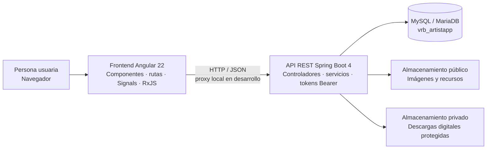

<div align="center">

# ArtistApp

### Un espacio digital para crear, compartir y encontrarse a través del arte.

Una comunidad para artistas independientes, organizadores y amantes del arte. Descubre obras, conecta con sus creadores, participa en eventos y explora una tienda de piezas originales.


**[Ver la demo en GitHub Pages](https://vanerb.github.io/Artistapp-Laravel-Angular/)**

</div>

---

## Sobre el proyecto

ArtistApp es una plataforma web que reúne en un mismo lugar una red social creativa, una agenda de eventos y una tienda para artistas. La aplicación se ha reconstruido con un frontend en Angular y una API REST en Java con Spring Boot, conservando compatibilidad con el esquema histórico de MySQL.

El objetivo es ofrecer a cada persona un espacio donde mostrar su trabajo, descubrir nuevos creadores y participar en una comunidad artística.

## Qué puedes hacer

| Área | Funcionalidades |
| --- | --- |
| **Descubrir** | Explorar obras, artistas y eventos; buscar, filtrar y recorrer resultados paginados. |
| **Comunidad** | Consultar perfiles, biografías, seguidores y seguidos; seguir cuentas y guardar obras favoritas. |
| **Publicaciones** | Compartir y gestionar obras, indicar que te gustan y conversar en los comentarios. |
| **Eventos** | Crear eventos según el tipo de cuenta, gestionar solicitudes y conversar en el chat grupal del evento. |
| **Mensajes** | Mantener conversaciones directas con otros usuarios desde una bandeja unificada. |
| **Tienda** | Publicar productos físicos o digitales, añadirlos a la cesta, comprar y consultar pedidos. |
| **Avisos** | Recibir notificaciones de actividad y comunicaciones importantes de administración. |
| **Administración** | Gestionar recursos de la plataforma desde un panel protegido. |
| **Cuenta** | Crear una cuenta, iniciar sesión, actualizar el perfil y gestionar la contraseña. |

### Tipos de cuenta

| Tipo | Permisos principales |
| --- | --- |
| Administrador | Panel de administración y gestión de la plataforma. |
| Artista | Publicar obras y gestionar productos para la tienda. |
| Organizador de eventos | Crear eventos y gestionar productos para la tienda. |
| Amante del arte | Descubrir, seguir artistas, comprar y participar en eventos. |

Los IDs históricos se mantienen: `1` administrador, `3` organizador, `5` artista y `7` amante del arte.

## Tecnologías y arquitectura

| Capa | Tecnología | Responsabilidad |
| --- | --- | --- |
| Frontend | Angular 22, TypeScript, Signals y RxJS | Interfaz, navegación, formularios y estado reactivo. |
| Backend | Spring Boot 4.1, Java 21 y JdbcTemplate | API JSON, autenticación por token, permisos y lógica de negocio. |
| Datos | MySQL / MariaDB compatible | Persistencia basada en el esquema histórico de ArtistApp; la API crea al arrancar lo que falte. |
| Desarrollo local | Proxy de Angular | Dirige `/api` y `/storage` hacia Spring Boot durante el desarrollo. |
| Demo | GitHub Pages | Frontend estático con la API simulada en el navegador sobre los datos de muestra. |

```text
Navegador
   │
   ▼
Angular · http://localhost:4200
   │  /api y /storage mediante proxy
   ▼
Spring Boot · http://127.0.0.1:8000
   │
   ├── MySQL · vrb_artistapp
   ├── Almacenamiento público · imágenes y archivos visibles
   └── Almacenamiento privado · descargas digitales protegidas
```

## Cómo está construido

ArtistApp separa la interfaz, la lógica de negocio y los datos. Angular presenta la aplicación y se comunica con Spring Boot mediante peticiones HTTP con respuestas JSON. La API valida cada petición, aplica las reglas de acceso y coordina la base de datos y los archivos.



### Interfaz Angular

La aplicación está organizada en páginas para cada área (descubrimiento, perfiles, eventos, tienda y administración) y componentes compartidos para elementos como la navegación, los modales y el chat. Los servicios del núcleo centralizan las llamadas a la API, la autenticación y el estado compartido. Angular Signals mantiene reactivos los datos de la sesión, la cesta y las notificaciones; RxJS gestiona los flujos asíncronos.

### API Spring Boot

El código está en `backend/src/main/java/com/artistapp`:

| Paquete | Contenido |
| --- | --- |
| `web` | Controladores REST, uno por área (`AuthController`, `ProductController`, `OrderController`...). Mantienen las rutas y el formato JSON de la API original, incluida la paginación `{current_page, data, last_page, total...}`. |
| `service` | Notificaciones internas, almacenamiento de archivos, marca de agua de las portadas (Java2D) y envío de correo. |
| `security` | Tokens Bearer compatibles con Laravel Sanctum (las sesiones existentes siguen siendo válidas), contraseñas bcrypt, conversión automática de los MD5 heredados y límite de intentos en las rutas de acceso. |
| `support` | Acceso SQL con `JdbcTemplate`, validación con las mismas reglas que antes y errores `{message, errors}`. |
| `config` | CORS, recursos estáticos y `SchemaInitializer`, que en cada arranque crea las tablas y columnas que falten, los catálogos y la cuenta de administración opcional, sin borrar datos. |

### Datos, imágenes y comunicación local

MySQL o MariaDB conserva las cuentas, publicaciones, relaciones, eventos, pedidos y demás información. Las imágenes se sirven desde almacenamiento público; los archivos digitales comprados se mantienen en almacenamiento privado para controlar su descarga. En desarrollo, el proxy de Angular reenvía `/api` y `/storage` al servidor Spring Boot, que se ejecuta por separado.

## Puesta en marcha

### Requisitos

- Node.js 24.15 o superior y npm.
- Java 21 o superior (JDK). Maven no hace falta: el proyecto incluye Maven Wrapper (`mvnw`).
- MySQL 8 o MariaDB compatible.

### 1. Configurar y arrancar el backend

La API se configura con variables de entorno (todas tienen un valor por defecto en `backend/src/main/resources/application.properties`):

| Variable | Por defecto | Uso |
| --- | --- | --- |
| `DB_HOST`, `DB_PORT`, `DB_DATABASE` | `127.0.0.1`, `3306`, `vrb_artistapp` | Conexión MySQL (la base se crea si no existe). |
| `DB_USERNAME`, `DB_PASSWORD` | `root`, vacío | Credenciales de MySQL. |
| `FRONTEND_URL` | `http://localhost:4200` | CORS y enlaces de recuperación de contraseña. |
| `ADMIN_EMAIL`, `ADMIN_PASSWORD`, `ADMIN_USERNAME`, `ADMIN_NAME` | vacío, vacío, `admin`, `Administración` | Si se indican, crea la cuenta de administración al arrancar. |
| `MAIL_HOST`, `MAIL_PORT`, `MAIL_USERNAME`, `MAIL_PASSWORD` | vacío, `587` | SMTP. Sin `MAIL_HOST`, los correos se escriben en el log. |
| `STORAGE_PATH` | `storage/app` | Carpeta de archivos públicos (`public/`) y privados (`private/`). |
| `APP_TIMEZONE` | `Europe/Madrid` | Zona horaria de fechas y mensajes. |

Para usar el volcado histórico, importa `BaseDeDatos/vrb_artistapp.sql`. Para una demo aislada, importa `BaseDeDatos/vrb_artistapp_muestra.sql` en una base vacía. En el SQL de muestra, las cuentas usan la contraseña `Usuario123`; los nombres y textos de muestra son ficticios.

Desde PowerShell, en la raíz del repositorio:

```powershell
cd .\backend
$env:DB_PASSWORD = "tu-contraseña"
.\mvnw.cmd spring-boot:run
```

En Linux o macOS: `cd backend && DB_PASSWORD=... ./mvnw spring-boot:run`.

La API queda en `http://127.0.0.1:8000`. Al arrancar crea las tablas y columnas que falten y completa los tipos de usuario, tipos de producto y categorías; se puede reiniciar tantas veces como se quiera sin duplicar datos ni borrar nada.

Para ejecutar los tests, que usan H2 en memoria y no necesitan MySQL: `.\mvnw.cmd test`.

Para generar un `.jar` ejecutable: `.\mvnw.cmd package` y después `java -jar target\artistapp-api-1.0.0.jar`.

### 2. Instalar y arrancar el frontend

En una segunda terminal, desde la raíz del repositorio:

```powershell
cd .\frontend
npm install
npm start
```

`npm start` ejecuta Angular con el proxy de desarrollo configurado. Abre [http://localhost:4200](http://localhost:4200). Mantén el backend activo en la otra terminal.

Para probar la versión de demostración (sin backend) en local: `npm run start:demo`.

Para compilar la aplicación:

```powershell
npm run build
```

### Restablecimiento de contraseña

Si no se configura `MAIL_HOST`, la API escribe los correos de recuperación en su log. Configura las variables `MAIL_*` para enviar correos reales.

## Demo en GitHub Pages

GitHub Pages solo sirve archivos estáticos, así que la demo publica el frontend Angular compilado con la configuración `demo`. En ella, un interceptor HTTP (`frontend/src/app/demo`) responde a las llamadas a `/api` dentro del navegador con las mismas rutas, permisos y respuestas que la API Spring Boot, a partir de `BaseDeDatos/vrb_artistapp_muestra.sql`. Los cambios (publicaciones, pedidos, mensajes...) se guardan en el `localStorage` de cada visitante y se pueden restablecer desde el aviso de la demo.

El workflow `.github/workflows/pages.yml` la compila y publica en cada push a `main`. Para activarlo la primera vez: **Settings → Pages → Build and deployment → Source: GitHub Actions**.

## Datos de demostración

El SQL de muestra conserva IDs, relaciones y rutas multimedia para poder recorrer la aplicación; las cuentas, eventos y textos de ejemplo son inventados. Las cuentas incluidas usan `Usuario123` como contraseña. No importes el SQL de muestra sobre una base que contenga datos que quieras conservar.

## Autora

**Vanesa Ribera Bautista** · Proyecto final de ciclo de Desarrollo de Aplicaciones Web.
